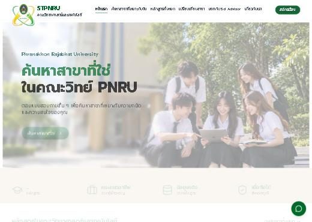
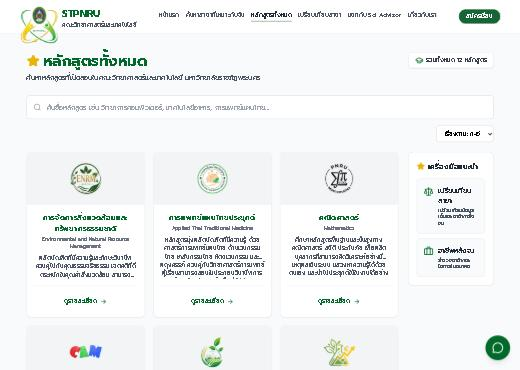
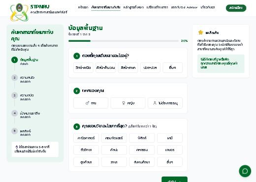
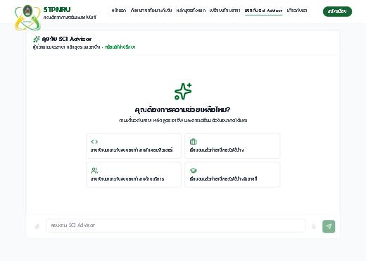
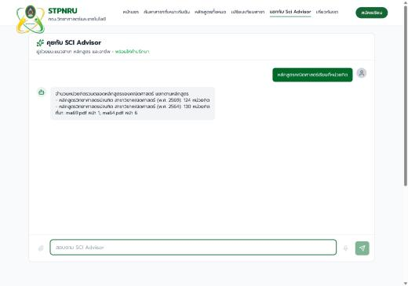

# รายงานความคืบหน้าโครงการ — Course Advisor System

**ข้อมูล ณ วันที่ 10 ตุลาคม 2569** · สำหรับรายงานออนไลน์วันจันทร์

---

## 1. ระบบนี้ทำอะไร

**ระบบแนะนำหลักสูตรด้วย AI** สำหรับคณะวิทยาศาสตร์ ให้นักเรียนถามเรื่องหลักสูตรแล้วได้คำตอบที่อ้างอิงจากเอกสาร มคอ. ของจริง

ผู้ใช้ถามคำถาม → ระบบค้นหาข้อความที่เกี่ยวข้องจากเอกสารหลักสูตรที่ทำดัชนีไว้ → ส่งให้ AI สรุปเป็นคำตอบ → ตอบกลับพร้อมแหล่งอ้างอิง

**จุดเด่นคือคำตอบมาจากเอกสารจริง ไม่ใช่ AI แต่งเอง** ทุกคำตอบตรวจสอบย้อนกลับไปยังหน้าในเอกสารได้

| ส่วนประกอบ | เทคโนโลยี |
|---|---|
| หน้าเว็บ | Next.js + React + TypeScript (ชื่อ Course Compass) |
| ระบบหลังบ้าน | FastAPI (Python) |
| ฐานข้อมูล | PostgreSQL + pgvector (เก็บทั้งข้อมูลและเวกเตอร์ในที่เดียว) |
| AI | Ollama รัน Qwen2.5 / Llama 3.x **บนเครื่องเราเอง** ไม่ต้องส่งข้อมูลออกนอก |
| เซิร์ฟเวอร์ | Oracle Cloud + Caddy (จัดการ HTTPS อัตโนมัติ) |

---

## 2. หน้าตาระบบจริง

ภาพทั้งหมดถ่ายจากเว็บจริงเมื่อ 11 ตุลาคม 2569 ไม่ใช่ภาพจำลอง

### หน้าแรก

### หลักสูตรทั้งหมด — แสดง 12 หลักสูตรที่เปิดสอนจริง

### แบบสอบถามหาสาขาที่เหมาะกับตัวเอง

### หน้าถาม-ตอบกับ Sci Advisor

### คำตอบจริงจากระบบ — ภาพที่อธิบายทั้งโครงการได้ในภาพเดียว

ถามว่า *"หลักสูตรคณิตศาสตร์เรียนกี่หน่วยกิต"* ได้คำตอบ

**คำตอบนี้แสดงผลงานสามอย่างพร้อมกัน**

| สิ่งที่เห็น | มาจากงานไหน |
|---|---|
| ตอบเป็นตัวเลขหน่วยกิตที่แน่นอน ไม่ใช่ข้อความคลุมเครือ | **MKO Phase 2** — ดึงข้อมูลเป็นโครงสร้างแล้วตอบจากข้อมูลนั้นโดยตรง |
| **แยกหลักสูตรปี 2569 (124 หน่วยกิต) ออกจากปี 2564 (130 หน่วยกิต)** | การแก้เรื่องหลักสูตรที่มีหลายฉบับ — เคยตอบสลับฉบับกัน |
| บอกแหล่งที่มาถึงระดับหน้า — `ma69.pdf หน้า 1`, `ma64.pdf หน้า 6` | ระบบอ้างอิงเอกสารต้นทาง ตรวจย้อนกลับได้ |

> ถ้ามีเวลาโชว์แค่ภาพเดียว **ให้ใช้ภาพนี้** เพราะพิสูจน์ได้ทันทีว่าระบบไม่ได้แต่งคำตอบเอง

---

## 3. ใครทำอะไร

เว็บไซต์นี้เป็นงานของสองฝั่งที่ทำงานร่วมกัน แยกหน้าที่ชัดเจนที่ชั้น Caddy

| คำขอที่เข้ามา | ไปที่ไหน | ฝั่งไหนรับผิดชอบ |
|---|---|---|
| `/api/chat` | ระบบหลังบ้าน FastAPI | **ฝั่งเรา** |
| `/api/*` อื่น ๆ | ระบบหลังบ้าน FastAPI | **ฝั่งเรา** |
| `/api/sci-connect-news*` | บริการเสริม webapi | **ฝั่งเรา** |
| `/api/admin/*` | บริการเสริม webapi | **ฝั่งเรา** |
| หน้าเว็บทั้งหมดที่เหลือ | ไฟล์ static ที่ `/srv/web` | **ทีมออกแบบ** |

**สรุปง่าย ๆ** — สิ่งที่ผู้ใช้*เห็น* เป็นงานของทีมออกแบบ · สิ่งที่ระบบ*ตอบ* เป็นงานของเรา

ในรีโปของเรายังมีหน้าเว็บอีกชุดหนึ่ง (Next.js 30 ไฟล์ 25 commit) ใช้เป็น**หน้าสำหรับผู้ดูแลและหน้าทดสอบด้วยมือ** เช่นหน้าตรวจทานข้อมูลที่ระบบดึงมาอัตโนมัติ ไม่ใช่หน้าที่นักเรียนเห็น

---

## 4. สถานะรวม — ใช้งานได้จริงแล้ว

**ระบบเปิดให้บริการอยู่ที่ `stpnru-advisor.duckdns.org` ทำงานต่อเนื่องไม่มีสะดุด**

| บริการ | สถานะ | ทำงานต่อเนื่อง |
|---|---|---|
| ฐานข้อมูล | ปกติ | **7 สัปดาห์** |
| AI (Ollama) | ปกติ | **7 สัปดาห์** |
| หน้าเว็บ | ปกติ | 11 วัน |
| ระบบหลังบ้าน | ปกติ | 11 วัน |
| บริการเสริมหน้าเว็บ | ปกติ | 2 สัปดาห์ |
| ตัวจัดการ HTTPS | ปกติ | 2 สัปดาห์ |

> ตัวเลข "11 วัน" ของหน้าเว็บและหลังบ้านคือรอบ deploy ล่าสุด ไม่ใช่การล่ม

---

## 5. ตัวเลขที่ใช้รายงานได้

### ปริมาณข้อมูลในระบบจริง

| รายการ | จำนวน |
|---|---|
| ชิ้นส่วนข้อความจากเอกสารหลักสูตร | **9,027** |
| ข้อความสนทนาที่เกิดขึ้นจริง | **6,070** |
| จำนวนการสนทนา | **3,132** |
| ผู้ใช้ในระบบ | **201** |
| หลักสูตรที่มีข้อมูล | **18** |
| เอกสาร มคอ. ที่ทำดัชนีแล้ว | **30** |
| คำตอบที่แคชไว้ (ตอบซ้ำได้เร็วขึ้น) | 144 |
| คำแนะนำหลักสูตรที่ระบบสร้างให้ | 47 |

**3,132 การสนทนาและ 6,070 ข้อความ** คือหลักฐานว่ามีคนใช้งานจริง ไม่ใช่แค่ระบบที่สร้างเสร็จแล้วตั้งทิ้งไว้

### งานพัฒนา

| รายการ | จำนวน |
|---|---|
| ระยะเวลาโครงการ | **13 ส.ค. – 10 ต.ค. 2569 (ประมาณ 2 เดือน)** |
| commit ทั้งหมดบนสายงานปัจจุบัน | **168** |
| ในนั้นเป็นการ**แก้ปัญหา** | **76** |
| เป็นการเพิ่มความสามารถ | 49 |
| เอกสารประกอบโครงการ | **156 ฉบับ** |
| ชุดทดสอบอัตโนมัติ (ส่วนบริการเสริม) | **82 ข้อ ผ่าน 82** |
| สคริปต์ประเมินคุณภาพคำตอบ | 32 ตัว |

---

## 6. ไทม์ไลน์ตั้งแต่เริ่ม และปัญหาที่เจอระหว่างทาง

**โครงการเริ่ม 13 สิงหาคม 2569 ถึงวันนี้ประมาณ 2 เดือน** · 168 commit · สิงหาคม 73 · กันยายน 83 · ตุลาคม 12

ส่วนนี้ตั้งใจเล่า**ปัญหาที่เจอจริงด้วย** ไม่ใช่เฉพาะสิ่งที่สำเร็จ เพราะงานส่วนใหญ่ของสองเดือนนี้คือการไล่แก้สิ่งที่พังตอนเจอผู้ใช้จริง

---

### 6.1 สิงหาคม — สร้างระบบและขึ้นใช้งานจริง

| วันที่ | ทำอะไร |
|---|---|
| 13 ส.ค. | commit แรก — ระบบหลังบ้าน + ไปป์ไลน์อ่าน PDF + AI + หน้าเว็บ |
| 14 ส.ค. | สนทนาต่อเนื่องหลายรอบได้ · เพิ่มการตรวจว่าคำตอบมาจากเอกสารจริง |
| 18 ส.ค. | **ขึ้น production ครั้งแรกบน Oracle Cloud** · แสดงคำตอบแบบไหลทีละคำ |
| 24–25 ส.ค. | เพิ่มทางเลือกใช้ Gemini และถอยกลับมาใช้โมเดลในเครื่องเมื่อโควตาหมด |
| 28–30 ส.ค. | ระบบจับคู่หลักสูตร · เปรียบเทียบหลักสูตร · ตอบเรื่องค่าเทอม · หน้าแรกใหม่ |

**ปัญหาที่เจอและแก้**

| ปัญหา | อาการที่เห็น | สาเหตุและทางแก้ |
|---|---|---|
| ไปป์ไลน์ภาษาไทยไม่ทำงานจริง | ถามแล้วไม่ได้คำตอบที่ตรง | ต้องรื้อให้ทำงานครบวงจรตั้งแต่อ่าน PDF ถึงตอบ |
| **ผลค้นหาหายไปเงียบ ๆ** | กรองเฉพาะหลักสูตรเดียวแล้วได้ผลน้อยผิดปกติ | ดัชนีเวกเตอร์แบบ `ivfflat` ตัดผลที่ถูกกรองทิ้ง — แก้วิธีค้นใหม่ |
| โมเดลที่เพิ่งปลุกขึ้นมาดูเหมือนแอปพัง | ผู้ใช้เห็นหน้าจอค้าง | ครั้งแรกหลังระบบตื่นต้องโหลดโมเดลก่อน — เพิ่มการบอกสถานะ |
| พอร์ตชนกับที่ Windows จองไว้ | รันไม่ขึ้นบนเครื่องพัฒนา | ย้ายพอร์ต |
| คำตอบแบบไหลทีละคำขาดตอน | ข้อความหยุดกลางคัน | ตัวกลางส่งต่อไม่รองรับ streaming — เปลี่ยนวิธีส่งต่อ |
| ตั้งค่า Gemini ไม่ผ่านทั้งที่คีย์ถูก | บันทึกคีย์ไม่ได้ | มีช่องว่างติดมาท้ายคีย์ · และโค้ดตรวจรูปแบบคีย์ด้วยกฎที่ล้าสมัย — เอาออกแล้วตรวจกับ Google จริงแทน |
| **โมเดลสำรองเดาตัวเลขออกมา** | ตอบจำนวนหน่วยกิตที่ไม่มีในเอกสาร | **บังคับไม่ให้ตอบด้วยตัวเลขที่โมเดลสำรองเดา** — ยอมไม่ตอบดีกว่าตอบผิด |

---

### 6.2 กันยายน — เปิดใช้ทั้งคณะ และไล่แก้คุณภาพคำตอบ

| วันที่ | ทำอะไร |
|---|---|
| 5 ก.ย. | **เปิด HTTPS และขึ้นโดเมนจริง** · ตอบเป็นภาษาเดียวกับที่ถาม |
| 8–9 ก.ย. | รับเอกสารหลักสูตรรุ่นใหม่ · **อ่าน PDF ที่เป็นรูปภาพได้ (OCR)** · ปรับระบบให้รองรับคนทั้งคณะ |
| 9 ก.ย. | ตั้งจำนวนเอกสารที่ดึงมาอ้างอิงที่ **25 ชิ้น จากการวัดจริง ไม่ใช่เดา** |
| 15–17 ก.ย. | **MKO Phase 1 และ 2** — ดึงข้อมูลเป็นโครงสร้าง แล้วเปิดใช้จริง |
| 21 ก.ย. | ให้นักเรียนเปิดเอกสารต้นทางที่คำตอบอ้างอิงได้ |
| 23 ก.ย. | เพิ่มบริการเสริมสำหรับข่าวและงานหลังบ้านของหน้าเว็บ |
| 28–30 ก.ย. | ระบบดึงข้อมูลอัตโนมัติ (crawler) พร้อมหน้าตรวจทาน |

**ปัญหาที่เจอและแก้**

| ปัญหา | อาการที่เห็น | สาเหตุและทางแก้ |
|---|---|---|
| คำถามภาษาอังกฤษหาเอกสารไทยไม่เจอ | ถามอังกฤษแล้วบอกว่าไม่มีข้อมูล | เอกสารเป็นไทยล้วน — ปรับให้ข้ามภาษาได้ |
| **แนะนำหลักสูตรที่คณะไม่เปิดแล้ว** | นักเรียนได้ชื่อหลักสูตรที่สมัครไม่ได้ | ตัดหลักสูตรที่ยกเลิกออกจากการแนะนำ |
| **บอกว่า "ไม่มีหลักสูตรที่เหมาะ" ทั้งที่จัดอันดับได้แล้ว** | นักเรียนถูกปฏิเสธทั้งที่ระบบหาเจอ | ขั้นอธิบายเหตุผลล้มแล้วถูกรายงานเป็น "ไม่มีหลักสูตรเหมาะ" — แยกสองกรณีออกจากกัน |
| **ส่งสารบัญไปเป็นหลักฐานหลัก** | คำตอบอ้างอิงหน้าสารบัญแทนเนื้อหา | สารบัญมีคำสำคัญครบเลยถูกเลือก — ตัดออกจากหลักฐาน |
| เลือกเอกสารผิดฉบับ | หลักสูตรที่มีทั้งตรีและโท ตอบสลับกัน | เพิ่มการแยกตามระดับปริญญา |
| **คะแนนเปลี่ยนตามลำดับที่หยิบ** | รันซ้ำได้คะแนนไม่เท่าเดิม | คำตอบเดียวกันต้องได้คะแนนเท่ากันเสมอ — แก้ให้ไม่ขึ้นกับลำดับ |
| ตอบเรื่อง "สาขานี้" ผิดตัว | ถามต่อเนื่องแล้วระบบเปลี่ยนไปพูดหลักสูตรอื่น | ทำให้คำอ้างอิงยึดกับหลักสูตรที่กำลังคุยอยู่ |

---

### 6.3 ตุลาคม — งานโครงสร้างและความปลอดภัย

| วันที่ | ทำอะไร |
|---|---|
| 1–2 ต.ค. | ออกแบบ schema สำหรับข้อมูลหน้าเว็บ · วางรากฐานระบบสิทธิ์ |
| 9 ต.ค. | เชื่อมตัวตนระหว่าง Supabase กับฐานข้อมูลหลัก (S1) · **M3** |
| 10 ต.ค. | ตรวจความพร้อม deploy · จัดทำคู่มือ deploy |

**ปัญหาที่เจอและแก้**

| ปัญหา | ทำไมอันตราย | ทางแก้ |
|---|---|---|
| **ตัวตนผู้ใช้ถูกเก็บไว้ในตัวแปรที่ใช้ร่วมกัน** | ถ้ามีคนใช้พร้อมกัน **ข้อมูลอาจถูกบันทึกในชื่อคนผิด** | เปลี่ยนให้ตัวตนเดินทางไปกับคำขอแต่ละอัน ไม่ใช้ตัวแปรร่วม |
| คีย์ของ schema ใหม่ไม่ตรงกับต้นทาง | ข้อมูลเชื่อมกันไม่ได้ | ตรวจกับของจริงแล้วแก้ให้ตรง |
| ไฟล์โค้ดหน้าเว็บบางส่วนไม่อยู่ใน version control | ถ้าเครื่อง production หาย จะกู้ไม่ได้ | ทำไฟล์สำรองพร้อมตรวจสอบความถูกต้อง และเขียนขั้นตอนกู้คืน |

---

### 6.4 บทเรียนที่บันทึกไว้ถาวร — 17 ข้อ

ปัญหาที่เสียเวลามากและมีโอกาสเกิดซ้ำ ถูกบันทึกไว้เป็นบันทึกถาวรเพื่อไม่ให้พลาดอีก ยกมา 6 ข้อที่เล่าได้ชัด

| บทเรียน | เรื่องที่เกิดขึ้น |
|---|---|
| **แคชบังการแก้ไข** | แก้โค้ดแล้วทดสอบได้พฤติกรรมเดิม เพราะคำตอบถูกดึงจากแคช ไม่ได้รันโค้ดใหม่ — เสียเวลาหาสาเหตุนาน ตอนนี้กฎคือเจออาการนี้ให้สงสัยแคชก่อน |
| **deploy ต้องสร้าง image ใหม่** | คัดลอกไฟล์ขึ้นเซิร์ฟเวอร์แล้ว restart จะยังรันโค้ดเก่า เพราะโค้ดถูก build ไว้ใน image แล้ว — ต้องตรวจในคอนเทนเนอร์เสมอว่าได้ของใหม่จริง |
| **429 ของ Gemini มีสองชนิด** | เคยเหมารวมว่าเกินโควตารายวันแล้วพักโมเดลหลักไป 4 ชั่วโมง ทั้งที่จริงเป็นแค่เพดานต่อนาที ระบบเลยตอบแย่ลงโดยไม่จำเป็น — แยกสองกรณีออกจากกันแล้ว |
| **คะแนนประเมินมีความผันผวนในตัว** | รันชุดเดิมสองครั้งได้ผลต่างกัน 3 ข้อโดยไม่ได้แก้อะไรเลย — ห้ามสรุปว่าดีขึ้นจากผลต่างเล็กน้อย ต้องวัดซ้ำ |
| **ตัวกรองห้ามดันอันดับล่างขึ้นมาแทน** | กรองแล้วเหลือน้อยต้องแสดงน้อย ไม่ใช่ไปหาตัวอื่นมาเติมให้ครบจำนวน เพราะตัวที่เติมมาคือตัวที่ถูกตัดสินแล้วว่าไม่เกี่ยว |
| **คอนเทนเนอร์ชื่อซ้ำกันระหว่างเครื่องพัฒนากับเซิร์ฟเวอร์** | เจอรอบนี้เอง — คำสั่งที่ตั้งใจรันบนเซิร์ฟเวอร์ไปโดนฐานข้อมูลบนเครื่องตัวเองโดยไม่มีอะไรเตือน ถ้าเป็นคำสั่งเขียนข้อมูลจะแย่มาก |

> **จุดร่วมของบทเรียนเกือบทุกข้อคือ "ผลที่ดูเหมือนถูกแต่ไม่ได้มาจากสิ่งที่คิด"** — แคชบังการแก้ โค้ดเก่าที่ยังรันอยู่ หรือคำสั่งที่ไปโดนเครื่องผิด ทั้งหมดให้ผลที่ดูสมเหตุสมผลจนไม่เอะใจ

---

## 7. ความสามารถที่ส่งมอบแล้ว

ไทม์ไลน์ข้างบนเล่าว่า **เกิดอะไรขึ้นเมื่อไหร่** · ส่วนนี้สรุปว่า **ตอนนี้ระบบทำอะไรได้บ้าง**

| ความสามารถ | สถานะ | ผู้ใช้เห็นที่ไหน |
|---|---|---|
| ถาม-ตอบเรื่องหลักสูตรโดยอ้างอิงเอกสารจริง | **ใช้งานจริง** | หน้า Sci Advisor |
| ตอบตัวเลขสำคัญจากข้อมูลโครงสร้าง ไม่ให้ AI เดา | **ใช้งานจริง** | คำตอบที่มีหน่วยกิต รายวิชา |
| แยกหลักสูตรที่มีหลายฉบับ/หลายระดับปริญญา | **ใช้งานจริง** | คำตอบระบุปี พ.ศ. ของหลักสูตร |
| บอกแหล่งอ้างอิงถึงระดับหน้าเอกสาร | **ใช้งานจริง** | บรรทัด "ที่มา:" ท้ายคำตอบ |
| เปิดเอกสารต้นทางที่คำตอบอ้างอิงได้ | **ใช้งานจริง** | ลิงก์ในคำตอบ |
| แนะนำสาขาที่เหมาะจากแบบสอบถาม | **ใช้งานจริง** | หน้าค้นหาสาขาที่ใช่ |
| เปรียบเทียบหลักสูตรหลายตัวพร้อมกัน | **ใช้งานจริง** | หน้าเปรียบเทียบสาขา |
| ตอบคำถามค่าเทอมจากตารางค่าธรรมเนียมจริง | **ใช้งานจริง** | ในบทสนทนา |
| ตอบภาษาเดียวกับที่ถาม (ไทย/อังกฤษ) | **ใช้งานจริง** | ในบทสนทนา |
| อ่านเอกสาร PDF ที่เป็นรูปภาพได้ (OCR) | **ใช้งานจริง** | เบื้องหลัง |
| ดึงข่าวและเอกสารใหม่เข้าระบบอัตโนมัติ | **ใช้งานจริง** | หน้าผู้ดูแล |
| ถอยไปใช้โมเดลสำรองเมื่อโควตาหมด | **ใช้งานจริง** | เบื้องหลัง |
| ระบบสิทธิ์ผู้ดูแลเชื่อมกับฐานข้อมูลหลัก (M3) | **พร้อมแล้ว รอ deploy** | หน้าผู้ดูแล |

### งานเบื้องหลังที่ไม่เห็นหน้าเว็บแต่สำคัญ

| งาน | ทำไมสำคัญ |
|---|---|
| **รวมฐานข้อมูลสองที่** — migration 6 รอบ พร้อมตรวจกับของจริงทุกรอบ | เดิมข้อมูลผู้ใช้ของเราและของหน้าเว็บไม่ตรงกัน |
| **ชุดทดสอบอัตโนมัติ 82 ข้อ** | จับปัญหาก่อนขึ้น production |
| **เอกสาร 156 ฉบับ** | ทุกการเปลี่ยนแปลงบน production มีบันทึกว่าทำอะไร ทำไม และย้อนกลับอย่างไร |
| **ขั้นตอน deploy ที่มีจุดย้อนกลับทุกครั้ง** | ไม่เคยแก้ production โดยไม่มีทางถอย |

---

## 8. งานที่กำลังทำ — M3 ระบบยืนยันตัวตนสำหรับผู้ดูแล

### ปัญหาที่แก้

หน้าเว็บใช้ Supabase ยืนยันตัวตน แต่ฐานข้อมูลหลักของเราเป็นอีกระบบหนึ่ง **ทำให้เวลาผู้ดูแลบันทึกข้อมูล ระบบไม่รู้ว่าใครเป็นคนทำ**

M3 เชื่อมสองระบบนี้เข้าด้วยกัน และเพิ่มด่านตรวจสิทธิ์ว่าใครเข้าถึงอะไรได้บ้าง

### สถานะ: **พร้อม deploy แล้ว ยังไม่ได้ deploy**

| การตรวจ | ผล |
|---|---|
| ทดสอบอัตโนมัติ | **82/82 ผ่าน** |
| สร้าง Docker image ทดสอบ | **ผ่าน** |
| ตรวจไฟล์ใน image ครบ | **ผ่าน** |
| ทดสอบรันจริง | **ผ่าน** |
| บัญชีผู้ดูแลพร้อมทดสอบ | **ยืนยันแล้ว** |
| จุดย้อนกลับ (rollback) | **เตรียมแล้ว** |
| เอกสารขั้นตอน deploy | **เสร็จ** พร้อมเงื่อนไขหยุด 12 ข้อ |

**รอการอนุมัติ deploy เท่านั้น**

### ทำไมถึงยังไม่ deploy

M3 เปลี่ยนเรื่องการตรวจสิทธิ์ซึ่งกระทบผู้ใช้โดยตรง ถ้าพลาดอาจล็อกผู้ดูแลออกจากระบบ จึงตรวจให้ครบก่อน ไม่รีบ

ระหว่างตรวจพบปัญหาจริง 3 จุดที่ถ้า deploy ไปเลยจะเจอปัญหา

1. **ไฟล์ตั้งค่าบนเซิร์ฟเวอร์ยังไม่มีส่วนของ M3** — ถ้าลืม ระบบจะขึ้นได้ปกติแต่การเชื่อมตัวตนไม่ทำงาน **โดยไม่มีอะไรฟ้อง**
2. **หน้าตรวจสุขภาพระบบพิสูจน์การเชื่อมต่อฐานข้อมูลไม่ได้** — ถ้ารหัสผ่านผิดจะผ่านการทดสอบทุกข้อ แล้วไปพังตอนใช้งานจริงครั้งแรก จึงเพิ่มขั้นตอนตรวจการเชื่อมต่อจริงเข้าไป
3. **ขั้นตอนย้อนกลับเดิมอาจไม่ย้อนจริง** — เปลี่ยนชื่อ image อย่างเดียวไม่พอ ต้องบังคับสร้างใหม่และยืนยันผล

---

## 9. สิ่งที่ยังค้าง

### ต้องทำก่อน/ตอน deploy M3

| # | เรื่อง | หมายเหตุ |
|---|---|---|
| 1 | ใส่รหัสผ่านฐานข้อมูลลงไฟล์ตั้งค่าบนเซิร์ฟเวอร์ | มีขั้นตอนเขียนไว้แล้ว ไม่แสดงรหัสผ่านบนจอ |
| 2 | ส่งไฟล์ 7 ตัวขึ้นเซิร์ฟเวอร์ | รวมไฟล์ที่เซิร์ฟเวอร์ยังไม่มี 3 ตัว |
| 3 | สำรองฐานข้อมูลก่อน | ใช้สคริปต์ที่มีอยู่แล้ว |
| 4 | ทดสอบหลัง deploy 11 ข้อ | **ไม่มีข้อไหนเขียนข้อมูลจริง** ออกแบบมาให้ปลอดภัย |

### ตัวเลขคุณภาพคำตอบ — ยังไม่มี และเหตุผล

รายงานนี้**ไม่มีตัวเลขว่าระบบตอบแม่นกี่เปอร์เซ็นต์** ซึ่งเป็นคำถามที่น่าจะถูกถาม จึงขออธิบายไว้ล่วงหน้า

มีชุดคำถามประเมิน 18 ข้อ และไฟล์ผลเก่า 14 ไฟล์ แต่**เลือกไม่นำมาใส่** เพราะ

| เหตุผล | รายละเอียด |
|---|---|
| เป็นคะแนนความคล้าย ไม่ใช่ผ่าน/ไม่ผ่าน | ค่าเฉลี่ย 0.58 แปลเป็น "แม่น 58%" ไม่ได้ จะทำให้เข้าใจผิด |
| ผลเก่าตั้งแต่ 15 ก.ย. | **ก่อนเปิด MKO Phase 2 บน production** จึงไม่ใช่สภาพระบบตอนนี้ |
| เทียบข้ามรอบไม่ได้ถ้าเกณฑ์เปลี่ยน | เป็นบทเรียนที่บันทึกไว้แล้วว่าห้ามทำ |
| ผลแกว่งในตัว | ขั้นที่ AI เป็นผู้ตัดสินให้ผลต่างกันได้ 3 ข้อโดยไม่ได้แก้อะไร ต้องรันซ้ำแล้วรายงานเป็นช่วง |

**ที่ยังไม่รันใหม่เพราะชุดประเมินสมัครบัญชีใหม่บน production ทุกครั้งที่รัน** — ตอนนี้มีบัญชี `eval-*` ค้างอยู่ในฐานข้อมูลจริงแล้ว **33 บัญชี** จากการรันครั้งก่อน ๆ (จากผู้ใช้ทั้งหมด 201 มี 191 ที่เป็นข้อมูลทดสอบ) การรันใหม่จะเพิ่มอีกหนึ่ง จึงขออนุมัติก่อน

> ถ้าถูกถามในที่ประชุม แนะนำให้ตอบว่า **"มีชุดประเมินอยู่ ผลรอบล่าสุดเก่ากว่าการเปลี่ยนแปลงครั้งสำคัญ กำลังจะวัดใหม่"** ซึ่งตรงกับความจริงและดีกว่าการยกเลขเก่ามาอ้าง

### งานระยะถัดไป

| # | เรื่อง | ความสำคัญ |
|---|---|---|
| 1 | **แก้ช่องโหว่ข้อมูลส่วนตัว** — ตาราง `user_profiles` ของ Supabase ตอนนี้ **ใครก็อ่านได้** ขณะที่เก็บอีเมลและชื่อจริงของผู้ดูแล | **ควรแก้** — M3 ไม่ได้แก้ข้อนี้ ต้องขออนุมัติแยก |
| 2 | ลดการเรียกซ้ำตอนตรวจสิทธิ์ | ปรับประสิทธิภาพ |
| 3 | เพิ่มไฟล์ตั้งค่าให้ build เร็วขึ้น | ปรับปรุงภายใน |
| 4 | จัดการพื้นที่ดิสก์เครื่องพัฒนา | ระหว่างทำงานเจอดิสก์เต็มจน Docker เปิดไม่ขึ้น แก้ชั่วคราวแล้ว |

---

## 10. ความเสี่ยงที่ควรรู้

| ความเสี่ยง | ระดับ | การจัดการ |
|---|---|---|
| ตาราง `user_profiles` อ่านได้โดยทุกคนขณะที่เก็บอีเมลผู้ดูแล | **สูง** | บันทึกไว้แล้ว รอขออนุมัติแก้แยก |
| ไฟล์โค้ดบางส่วนของหน้าเว็บไม่ได้อยู่ใน version control | กลาง | มีไฟล์สำรองพร้อมตรวจสอบความถูกต้อง และเอกสารขั้นตอนกู้คืนแล้ว |
| deploy M3 แล้วล็อกผู้ดูแลออกจากระบบ | กลาง | มีจุดย้อนกลับพร้อม ทดสอบขั้นตอนย้อนกลับไว้แล้ว |
| เครื่องพัฒนามีคอนเทนเนอร์ชื่อซ้ำกับเซิร์ฟเวอร์จริง | กลาง | บันทึกเป็นข้อควรระวังแล้ว — คำสั่งที่ตั้งใจให้รันบนเซิร์ฟเวอร์ต้องผ่าน ssh เสมอ |

---

## 11. สรุปสำหรับที่ประชุม

### ถ้ามีเวลาพูด 1 นาที

> ระบบเปิดใช้งานจริงแล้ว มีการสนทนาเกิดขึ้น **3,132 ครั้ง** ข้อความ **6,070 ข้อความ** ฐานข้อมูลและ AI ทำงานต่อเนื่องมา **7 สัปดาห์ไม่สะดุด**
>
> รอบนี้ทำเรื่องความถูกต้องของคำตอบเสร็จและเปิดใช้งานแล้ว ตอนนี้กำลังจะขึ้นระบบยืนยันตัวตนสำหรับผู้ดูแล ตรวจครบแล้วทุกข้อ รอแค่อนุมัติ

**แล้วเปิดภาพคำตอบจริงในหัวข้อ 2** พร้อมพูดว่า *"ระบบตอบหน่วยกิตได้แม่น แยกหลักสูตรคนละปีออกจากกัน และบอกได้ว่าเอามาจากเอกสารไหนหน้าไหน"* — หนึ่งภาพอธิบายงานทั้งโครงการ

### ถ้าถูกถามว่า "คืบหน้าไปกี่เปอร์เซ็นต์"

ตอบเป็นงานจะชัดกว่าเปอร์เซ็นต์

- **ระบบหลักใช้งานได้ครบแล้ว** — ถาม-ตอบ ค้นหาหลักสูตร แนะนำหลักสูตร สมัคร/เข้าสู่ระบบ หน้าผู้ดูแล
- **งานคุณภาพคำตอบรอบใหญ่เสร็จและเปิดใช้แล้ว**
- **เหลืองานระบบสิทธิ์ผู้ดูแล ซึ่งตรวจเสร็จแล้วรอ deploy**
- **เหลือเรื่องความปลอดภัยข้อมูลส่วนตัว 1 จุดที่ควรแก้**

### ถ้าถูกถามว่า "ทำไมใช้เวลานาน"

จาก 168 commit มี **76 commit ที่เป็นการแก้ปัญหา** มากกว่าการเพิ่มความสามารถ (49) — สะท้อนว่างานส่วนใหญ่คือการไล่แก้สิ่งที่พังตอนเจอผู้ใช้จริง ไม่ใช่การสร้างของใหม่เรื่อย ๆ

ตัวอย่างปัญหาที่หาสาเหตุยากและกินเวลา

- **โมเดลสำรองเดาตัวเลขหน่วยกิตออกมา** ทั้งที่ไม่มีในเอกสาร — ต้องบังคับให้ยอมไม่ตอบดีกว่าตอบผิด
- **ระบบบอกนักเรียนว่าไม่มีหลักสูตรที่เหมาะ** ทั้งที่จัดอันดับได้แล้ว เพราะขั้นอธิบายเหตุผลล้มแล้วถูกรายงานผิดประเภท
- **เคยพักโมเดลหลักไป 4 ชั่วโมง** เพราะเข้าใจผิดว่าโควตารายวันหมด ทั้งที่เป็นแค่เพดานต่อนาที
- **แก้โค้ดแล้วทดสอบได้พฤติกรรมเดิม** เพราะคำตอบถูกดึงจากแคช ไม่ได้รันโค้ดใหม่

ทั้งหมดนี้เป็นปัญหาที่ **"ผลดูเหมือนถูกแต่ไม่ได้มาจากสิ่งที่คิด"** ซึ่งถ้าไม่ไล่ให้ถึงต้นตอจะกลับมาอีก จึงบันทึกไว้เป็นบทเรียนถาวร **17 ข้อ** และเขียนเอกสารไว้ทุกรอบรวม **156 ฉบับ**

ตัวอย่างที่เห็นผล: รอบตรวจ M3 เจอปัญหา 3 จุดที่ถ้า deploy ไปเลยจะเจอตอนระบบใช้งานจริง จุดหนึ่งคือถ้ารหัสผ่านฐานข้อมูลผิด **ระบบจะผ่านการทดสอบทุกข้อแล้วไปพังตอนผู้ดูแลกดบันทึกข้อมูลครั้งแรก** ซึ่งตอนนั้นจะหาสาเหตุยากมาก

### ถ้าถูกถามว่า "ขั้นต่อไปคืออะไร"

1. อนุมัติ deploy M3 (พร้อมแล้ว)
2. ทดสอบหลัง deploy 11 ข้อ
3. ขออนุมัติแก้ช่องโหว่ข้อมูลส่วนตัว

---

## 12. ภาคผนวก — ที่มาของตัวเลข

ตัวเลขทั้งหมดในรายงานนี้ดึงจากระบบจริงเมื่อ 10 ตุลาคม 2569 ไม่ใช่ค่าประมาณ

| ตัวเลข | ที่มา |
|---|---|
| ปริมาณข้อมูล | นับจากฐานข้อมูล production โดยตรง |
| สถานะบริการ | `docker ps` บนเซิร์ฟเวอร์จริง |
| ผลทดสอบ | รันชุดทดสอบจริง 82 ข้อ |
| จำนวน commit และเอกสาร | นับจาก repository |
| ภาพหน้าจอ | ถ่ายจากเว็บจริง `stpnru-advisor.duckdns.org` เมื่อ 11 ต.ค. 2569 |
| คำตอบในภาพ | ถามจริงผ่านหน้าเว็บ ไม่ได้จัดฉากหรือตัดต่อ |

> ไม่มีรหัสผ่าน โทเคน อีเมล หรือข้อมูลส่วนบุคคลในรายงานฉบับนี้
